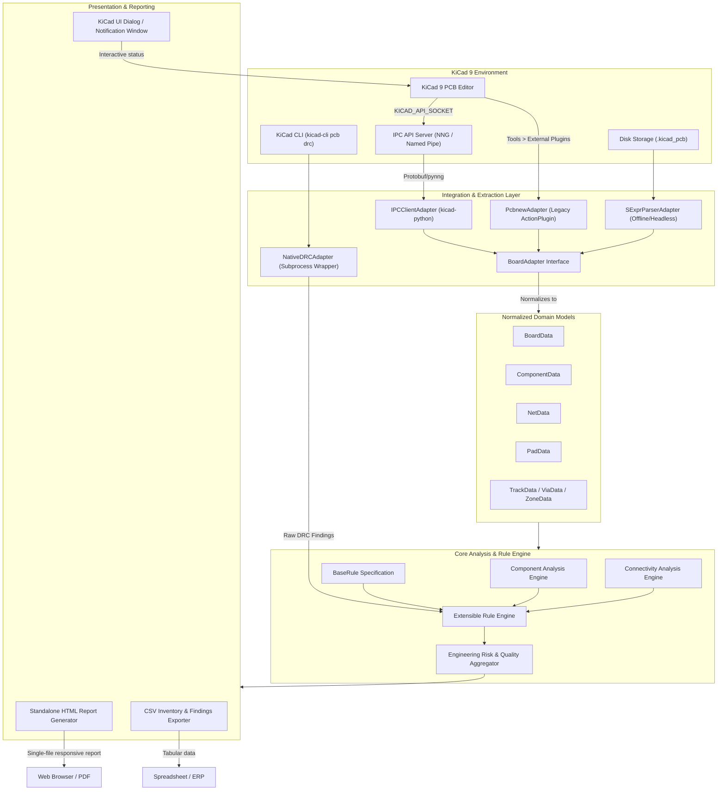
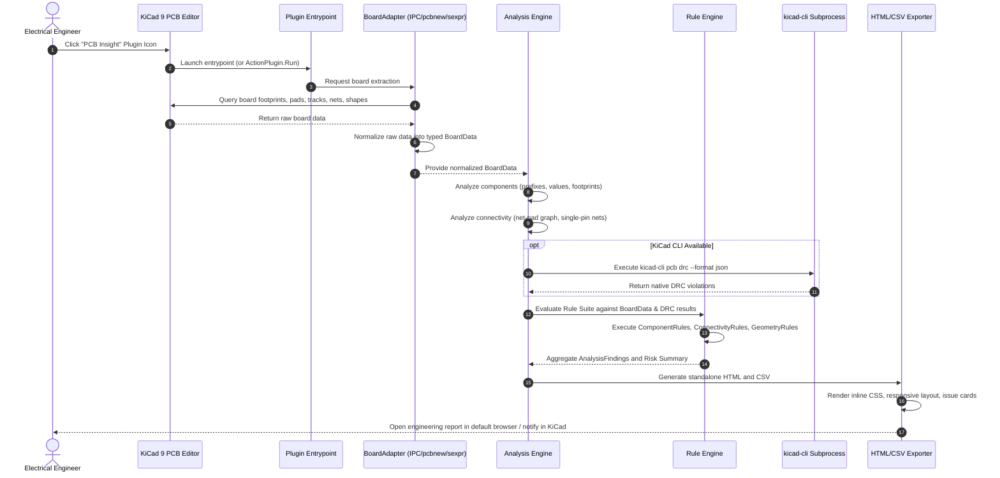

# System Architecture & Technical Specification
**Project:** PCB Insight – Intelligent PCB Design Analyzer for KiCad 9  
**Submission:** FOSSEE eSim Semester Long Internship – Screening Task 6  

---

## 1. Architectural Philosophy

PCB Insight is engineered following **Clean Architecture** and the **Ports-and-Adapters (Hexagonal) Pattern**. The software decouples:
1. **Infrastructure & External Bindings:** KiCad IPC API (`kicad-python`), legacy `pcbnew`, and `.kicad_pcb` disk parsers.
2. **Domain Core:** Normalized data models representing electronic components, nets, pads, traces, and physical properties.
3. **Application Services:** Component analyzer, connectivity auditor, and rule evaluation engine.
4. **Presentation & Output:** Standalone HTML reporting, CSV export, and KiCad GUI integration dialogs.

---

## 2. High-Level System Architecture Diagram



---

## 3. Module Breakdown & Responsibilities

```
PCB-Insight-KiCad9/
├── pcb_insight/
│   ├── __init__.py                  # Package root and version info
│   ├── plugin_entry.py              # CLI and IPC action entrypoint
│   │
│   ├── integration/                 # KiCad integration & data extraction
│   │   ├── __init__.py
│   │   ├── adapter_interface.py     # Abstract BoardAdapter ABC
│   │   ├── ipc_adapter.py           # kicad-python IPC client implementation
│   │   ├── pcbnew_adapter.py        # Legacy SWIG pcbnew ActionPlugin implementation
│   │   ├── sexpr_parser.py          # Native pure-Python S-expression parser
│   │   └── drc_runner.py            # kicad-cli DRC execution & JSON parser
│   │
│   ├── core/                        # Normalized Domain Data Models
│   │   ├── __init__.py
│   │   ├── data_models.py           # Dataclasses: BoardData, ComponentData, NetData, etc.
│   │   ├── component_analyzer.py    # Grouping, prefix analysis, BOM auditing
│   │   ├── connectivity_analyzer.py # Net-to-pad graph, unassigned nets, floating pads
│   │   └── analysis_engine.py       # Orchestration pipeline
│   │
│   ├── rules/                       # Extensible Quality Rule Engine
│   │   ├── __init__.py
│   │   ├── base_rule.py             # Rule interface, Severity enum, Finding dataclass
│   │   ├── rule_engine.py           # Registry, pipeline execution, filtering
│   │   ├── component_rules.py       # Reference, value, footprint, duplicate rules
│   │   ├── connectivity_rules.py    # Single-pin net, unassigned net, power pin rules
│   │   └── geometry_rules.py        # Board outline, dimension, layer sanity rules
│   │
│   ├── reporting/                   # Report Generation
│   │   ├── __init__.py
│   │   ├── html_report.py           # Responsive, offline HTML builder with inline CSS/JS
│   │   ├── csv_exporter.py          # CSV exporter for components and findings
│   │   └── risk_summary.py          # Engineering metrics, finding aggregations
│   │
│   ├── ui/                          # User Interface & Dialogs
│   │   ├── __init__.py
│   │   └── main_window.py           # Plugin UI window with progress and actions
│   │
│   └── utils/                       # Common Utilities
│       ├── __init__.py
│       ├── logging_config.py        # Centralized structured logging
│       ├── file_utils.py            # Safe atomic path and file handlers
│       └── validators.py            # Input validation routines
```

---

## 4. End-to-End Data Flow Diagram



---

## 5. Normalized Domain Data Models

All internal business logic consumes strongly-typed, immutable or validated dataclasses defined in `pcb_insight/core/data_models.py`:

```python
from dataclasses import dataclass, field
from enum import Enum
from typing import List, Dict, Optional, Tuple

class FindingSeverity(Enum):
    INFO = "info"
    WARNING = "warning"
    ERROR = "error"

@dataclass(frozen=True)
class PadData:
    pad_number: str
    net_name: str
    net_code: int
    pad_type: str            # "PTH", "SMD", "NPTH", etc.
    position_x_mm: float
    position_y_mm: float
    size_x_mm: float
    size_y_mm: float
    layers: Tuple[str, ...]

@dataclass
class ComponentData:
    reference: str           # e.g., "R1", "C3", "U2"
    prefix: str              # e.g., "R", "C", "U"
    value: str               # e.g., "10k", "0.1uF", "NE555"
    footprint_name: str      # e.g., "Resistor_SMD:R_0805_2012Metric"
    layer: str               # "F.Cu" or "B.Cu"
    position_x_mm: float
    position_y_mm: float
    orientation_deg: float
    pads: List[PadData] = field(default_factory=list)
    attributes: Dict[str, str] = field(default_factory=dict)
    is_dnp: bool = False      # Do Not Populate

@dataclass
class NetData:
    code: int
    name: str
    pad_count: int = 0
    pads: List[Tuple[str, str]] = field(default_factory=list)  # [(ref, pad_num), ...]
    is_power: bool = False
    is_ground: bool = False

@dataclass
class BoardData:
    name: str
    file_path: Optional[str]
    dimensions_mm: Tuple[float, float]
    bounding_box: Tuple[float, float, float, float]  # min_x, min_y, max_x, max_y
    copper_layer_count: int
    enabled_layers: List[str]
    components: List[ComponentData] = field(default_factory=list)
    nets: Dict[str, NetData] = field(default_factory=dict)
    track_count: int = 0
    via_count: int = 0
    zone_count: int = 0
    has_edge_cuts: bool = False
    metadata: Dict[str, str] = field(default_factory=dict)
```

---

## 6. Key Engineering Algorithms

### 6.1 Net-to-Pad Connectivity Graph Construction
1. For every component $C \in \text{components}$ and every pad $P \in C.\text{pads}$:
   - Extract pad net string $N = P.\text{net\_name}$.
   - If $N$ is empty, null, or indicates unconnected (e.g. `""` or `None`):
     - Record pad in `unconnected_pads` list with mechanical/electrical classification (PTH vs NPTH vs SMD).
   - If $N$ is valid:
     - Register $(C.\text{reference}, P.\text{pad\_number})$ into $\text{nets}[N].\text{pads}$.
     - Increment $\text{nets}[N].\text{pad\_count}$.
2. Traverse all nets in $\text{nets}$:
   - If $\text{pad\_count} == 1$:
     - Flag net as **Single-Pin Net** (`RULE-CONN-001`), indicating an antenna, stub, or incomplete net label.
   - If $\text{pad\_count} == 0$:
     - Flag net as **Empty Net Definition** (`RULE-CONN-002`).

### 6.2 Component Reference Designator Categorization
Components are classified by standard IEEE 315 / IEEE 200 reference designators:
- `R`: Resistors
- `C`: Capacitors
- `L`: Inductors / Ferrite beads
- `D`: Diodes / LEDs / TVS
- `Q`: Transistors / MOSFETs
- `U` or `IC`: Integrated Circuits
- `J` or `P`: Connectors / Headers
- `SW`: Switches / Buttons
- `TP`: Test Points
- `FID`: Fiducial Markers
- `H` or `MH`: Mounting Holes

Findings are generated for:
- Missing references (e.g., `""`, `"?"`, `"REF**"`).
- Duplicate references (multiple distinct components claiming identical designator `R1`).
- Empty value fields (`""`, `"~"`).
- Missing footprint assignments.

---

## 7. Security and Defensive Architecture

1. **Air-Gapped Operation:** All analyses and reports operate locally. No socket connections to external internet hosts.
2. **Read-Only Invariant:** PCB Insight treats the KiCad board model as read-only. It never writes back to the active board file or mutates PCB primitives unless explicitly initiated by the user for an intentional batch fix.
3. **Safe Subprocess Construction:** Native DRC invocation passes structured argument lists (`["kicad-cli", "pcb", "drc", "--format", "json", path]`), never shell strings with `shell=True`, preventing command injection vulnerabilities.
4. **Defensive Value Coercion:** All coordinate parsing converts from KiCad internal nanometers ($1\text{ mm} = 1,000,000\text{ nm}$) with safe rounding and default fallbacks.
