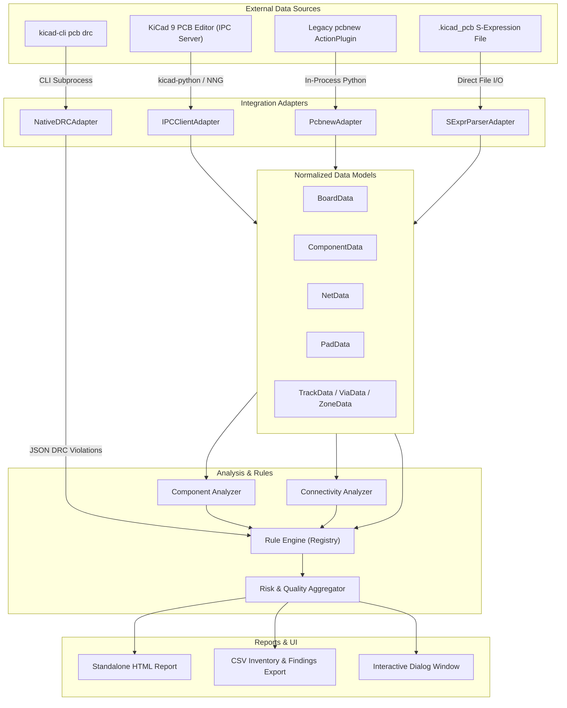
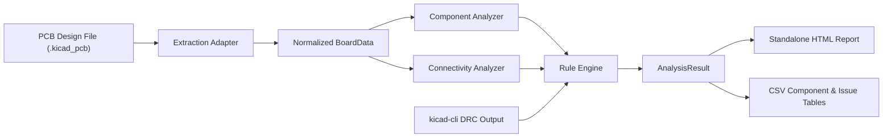
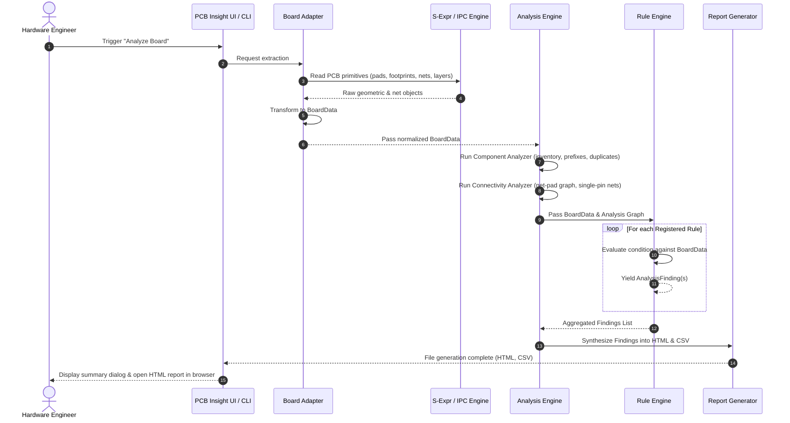

# PCB INSIGHT: Comprehensive Engineering Design Document
## Intelligent PCB Design Analysis, Connectivity Auditing, and Engineering Report Generation for KiCad 9

**Author:** Antigravity Engineering & Design Architecture Team  
**Target Candidate:** Screening Task 6 – FOSSEE eSim Semester Long Internship (Autumn 2026)  
**Document Revision:** 1.0.0  
**Date:** November 23, 2026  
**Status:** Pre-Implementation Specification (Proposal Awaiting Approval)

---

## Table of Contents
1. Abstract
2. Introduction
3. Problem Statement
4. Motivation
5. Objectives
6. Proposed Solution
7. Functional Requirements
8. Non-Functional Requirements
9. System Architecture
10. Architecture Diagram
11. Module Breakdown
12. Data Flow Diagram
13. Sequence Diagram
14. KiCad API Integration
15. PCB Data Extraction
16. Electronics Concepts Used
17. Rule Engine Design
18. Analysis Algorithms
19. Report Generation
20. Error Handling
21. Security and Reliability Considerations
22. Testing Methodology
23. Results and Demonstration
24. Limitations
25. Future Enhancements
26. Conclusion
27. References

---

## 1. Abstract
In modern Electronic Design Automation (EDA), the boundary between schematic capture, physical layout, and manufacturing readiness is frequently obscured by subtle human oversights, metadata inconsistencies, and layout-level net discontinuities. While KiCad's internal Design Rule Checker (DRC) is highly capable at identifying physical clearance violations and simple unrouted ratsnest items, it provides limited high-level electronic sanity auditing, Bill of Materials (BOM) hygiene verification, or executive-level risk reporting.

**PCB Insight** is an intelligent, modular, and explainable PCB design analysis utility developed specifically for **KiCad 9**. Leveraging KiCad 9's modern Inter-Process Communication (IPC) architecture and `kicad-python` API, alongside a robust fallback for legacy `pcbnew` Action Plugins and a headless `.kicad_pcb` S-expression parser, PCB Insight inspects printed circuit board assemblies, verifies electrical net-to-pad relationships, audits component metadata, executes an extensible electronics rule engine, and synthesizes standalone, interactive engineering reports.

---

## 2. Introduction
KiCad has evolved into an industry-grade open-source EDA suite used worldwide by universities, research institutions, startups, and defense contractors. With the release of KiCad 9, the EDA platform embarked on a significant architectural transition: deprecating legacy in-process SWIG Python bindings (`pcbnew`) in favor of an out-of-process, Protocol-Buffer-driven Inter-Process Communication (IPC) API.

Screening Task 6 of the FOSSEE eSim Semester Long Internship mandates the creation of a technically serious, genuinely integrated KiCad 9 utility that bridges computer science (modular object-oriented architecture, algorithms, rule engines, typed data models, data serialization) with electronics engineering (pad-net topologies, footprint geometry, reference designators, Bill of Materials integrity, and Design for Manufacturing concepts).

---

## 3. Problem Statement
Design engineers face several persistent challenges when finalizing PCB layouts in KiCad:
1. **Metadata Inconsistencies:** Schematics often pass netlist generation with empty values (`~`), default footprint assignments, or unassigned reference designators (`R?`, `REF**`) that cause assembly failures or expensive production delays.
2. **Hidden Net Connectivity Traps:** Nets containing only a single pin (often created accidentally by lingering net labels or broken schematic wires) act as unintended RF antennas and signal stubs without triggering severe physical DRC errors.
3. **Decoupling and Power Pin Omissions:** Unconnected IC supply pins or floating ground pads on IC thermal slugs frequently pass unnoticed if physical clearance rules are satisfied.
4. **Lack of Automated Verification Documentation:** Generating an executive or peer-review report currently requires manual screenshots, external spreadsheets, and labor-intensive assembly note authoring.

---

## 4. Motivation
Existing third-party tools are typically divided into two extremes:
- Heavyweight enterprise cloud viewers that require uploading proprietary PCB files to external commercial servers, violating intellectual property boundaries and air-gapped lab constraints.
- Toy hobbyist scripts that directly access KiCad internal C++ pointers without defensive handling, crashing KiCad or breaking across minor version upgrades.

PCB Insight is motivated by the need for an open-source, locally executing, explainable, and forward-compatible engineering tool that respects KiCad 9's evolving API landscape while delivering immediate value to hardware designers.

---

## 5. Objectives
1. **KiCad 9 Modern Integration:** Utilize KiCad 9's IPC API (`kicad-python`) via out-of-process execution while supporting legacy in-editor Action Plugins.
2. **Zero-Hardcoding & Robustness:** Never assume hardcoded local user paths; use dynamic environment discovery (`KICAD_API_SOCKET`, standard OS plugin paths).
3. **Deep Electronics Inspection:** Extract and validate component inventories, footprint assignments, pad-to-net connectivity matrices, and board boundary parameters.
4. **Explainable Rule Engine:** Ensure every reported finding features a unique Rule ID, severity classification, technical justification, affected components/nets, and actionable remediation steps.
5. **Native KiCad DRC Traceability:** Ingest authoritative results from `kicad-cli pcb drc --format json` without duplicating or faking native clearance calculations.
6. **Air-Gapped Professional Reporting:** Generate responsive, self-contained HTML/CSS/JS engineering reports and CSV tables with zero external network dependencies.
7. **Empirical Quality Assurance:** Implement complete unit, integration, and fixture-based regression tests covering clean designs and intentionally faulted boards.

---

## 6. Proposed Solution
PCB Insight implements a **Hexagonal (Ports-and-Adapters) Clean Architecture**:
- **Integration Adapters** abstract the data acquisition layer (`IPCClientAdapter`, `PcbnewAdapter`, and `SExprParserAdapter`).
- Raw representations are transformed into strongly-typed **Normalized Data Models** (`BoardData`, `ComponentData`, `NetData`, `PadData`).
- Specialized domain engines perform **Component Analysis**, **Connectivity Auditing**, and **Rule Evaluation**.
- An **Engineering Risk Aggregator** calculates transparent health metrics without arbitrary scoring gimmicks.
- The **Reporting Engine** exports clean, print-ready HTML and CSV artifacts.

---

## 7. Functional Requirements (FR)
- **FR-1 (Board Extraction):** Read board dimensions, layer stackup, component list, pad list, net list, tracks, vias, zones, and edge cut outlines.
- **FR-2 (Component Auditing):** Classify components by IEEE reference prefixes; detect duplicates, missing values, placeholder designators, and unassigned footprints.
- **FR-3 (Connectivity Graph):** Construct net-to-pad mappings; detect single-pin nets, empty nets, unassigned pads, and distinguish mechanical (NPTH) vs. electrical pads.
- **FR-4 (Extensible Rule Engine):** Provide modular rule execution with configurable severity (`INFO`, `WARNING`, `ERROR`).
- **FR-5 (Native DRC Ingestion):** Safely invoke `kicad-cli pcb drc` when available and parse JSON output.
- **FR-6 (Report Generation):** Generate standalone offline HTML reports and CSV exports of component inventory and findings.
- **FR-7 (User Interface):** Provide seamless launch options within KiCad 9 PCB Editor and standalone CLI capability.

---

## 8. Non-Functional Requirements (NFR)
- **NFR-1 (Platform Portability):** Operate seamlessly on Windows, Linux, and macOS.
- **NFR-2 (Security & Privacy):** 100% local execution; zero outbound network traffic; read-only board access.
- **NFR-3 (Performance):** Complete analysis of typical 500-component boards in under 2 seconds.
- **NFR-4 (Maintainability):** Full PEP 8 compliance, explicit type annotations, centralized logging, and zero circular imports.
- **NFR-5 (Testability):** Headless execution capability for all core algorithms independent of running GUI instances.

---

## 9. System Architecture
The application separates concerns across four distinct architectural layers:

1. **Infrastructure / Integration Layer (`pcb_insight.integration`):**
   Handles external communication with KiCad 9 IPC socket, legacy SWIG C++ bindings, or raw `.kicad_pcb` files.
2. **Domain Model Layer (`pcb_insight.core.data_models`):**
   Defines normalized, framework-independent data structures using Python dataclasses.
3. **Application & Rule Engine Layer (`pcb_insight.core`, `pcb_insight.rules`):**
   Contains pure algorithmic logic for connectivity graphs, component auditing, and rule evaluation.
4. **Presentation & Export Layer (`pcb_insight.reporting`, `pcb_insight.ui`):**
   Renders HTML/CSS reports, outputs CSV files, and displays desktop dialogs.

---

## 10. Architecture Diagram

---

## 11. Module Breakdown
- `pcb_insight/integration/adapter_interface.py`: Abstract Base Class `BoardAdapter` specifying `extract_board_data() -> BoardData`.
- `pcb_insight/integration/ipc_adapter.py`: Client for KiCad 9 IPC API using `kicad-python`.
- `pcb_insight/integration/pcbnew_adapter.py`: Fallback bridge for KiCad's legacy `pcbnew` Python module.
- `pcb_insight/integration/sexpr_parser.py`: Robust, recursive S-expression tokenizer and parser for `.kicad_pcb` files.
- `pcb_insight/integration/drc_runner.py`: Safe subprocess runner for `kicad-cli pcb drc --format json`.
- `pcb_insight/core/data_models.py`: Strongly-typed dataclasses for board geometry, components, nets, and findings.
- `pcb_insight/core/component_analyzer.py`: Reference grouping, prefix resolution, value syntax checking.
- `pcb_insight/core/connectivity_analyzer.py`: Net-pad graph formulation, floating pad and single-pin net detection.
- `pcb_insight/rules/base_rule.py`: `BaseRule` abstract class, `FindingSeverity`, and `AnalysisFinding`.
- `pcb_insight/rules/rule_engine.py`: Dynamic rule registration, execution pipeline, and summary aggregator.
- `pcb_insight/reporting/html_report.py`: Offline-capable, responsive HTML generator.
- `pcb_insight/reporting/csv_exporter.py`: RFC 4180-compliant CSV generator.
- `pcb_insight/ui/main_window.py`: Native GUI window for interactive execution.

---

## 12. Data Flow Diagram

---

## 13. Sequence Diagram

---

## 14. KiCad API Integration

### Modern KiCad 9 IPC API Flow
1. KiCad 9 declares plugins via `plugin.json` containing runtime specification `"type": "python"` and actions.
2. KiCad invokes the plugin process passing the socket location in `KICAD_API_SOCKET`.
3. PCB Insight instantiates `kipy.kicad.KiCad()`, which connects over the Nanomsg-NG socket (Named Pipe on Windows).
4. `kicad.get_board()` returns the remote `Board` proxy.
5. Proxied primitives (`get_footprints()`, `get_pads()`, `get_tracks()`, `get_nets()`, `get_shapes()`) are streamed over Protocol Buffers and normalized.

### Legacy Action Plugin Flow
1. Plugin registers with `pcbnew.ActionPlugin`.
2. In `Run()`, calls `board = pcbnew.GetBoard()`.
3. Traverses `board.GetFootprints()`, `board.GetTracks()`, `board.GetNets()`.
4. Normalizes C++ objects into `BoardData`.

---

## 15. PCB Data Extraction
Units are strictly normalized:
- KiCad internal coordinates (nanometers) are converted to millimeters ($1\text{ mm} = 10^6\text{ nm}$).
- Angles are normalized to degrees ($0.0^\circ \le \theta < 360.0^\circ$).
- Coordinates preserve origin offsets and layer assignments.
- Missing values (e.g. unassigned values or footprints) are normalized to explicit `None` or sentinel empty strings rather than raising uncaught attribute errors.

---

## 16. Electronics Concepts Used
1. **Reference Designators (IEEE 315 / IEEE 200):** Standard prefixes (`R`, `C`, `L`, `D`, `Q`, `U`, `J`, `TP`).
2. **Bill of Materials (BOM) Hygiene:** Detection of missing values (`~`), placeholder designators, and unassigned footprints.
3. **Electrical Net Topology:** Pad-to-net connectivity matrices, distinction between signal nets, power planes (`VCC`, `+3V3`, `+5V`), and ground returns (`GND`).
4. **Pad Types:** Plated Through-Hole (PTH), Surface Mount Device (SMD), Non-Plated Through-Hole (NPTH), and Edge Connectors.
5. **Single-Pin Nets:** Detection of dangling nets that act as inadvertent stubs and antennas.
6. **Physical Board Outline:** Verification of the `Edge.Cuts` layer boundary continuity.

---

## 17. Rule Engine Design
The rule engine utilizes an extensible Strategy pattern:
- **`BaseRule` Interface:**
  - `rule_id`: Unique alphanumeric identifier (e.g. `RULE-COMP-001`).
  - `name`: Human-readable title.
  - `description`: Plain-language explanation of the check.
  - `severity`: `FindingSeverity.ERROR`, `FindingSeverity.WARNING`, or `FindingSeverity.INFO`.
  - `evaluate(board_data: BoardData) -> List[AnalysisFinding]`.
  - `remediation`: Concrete advice on how to fix the issue in KiCad.

### Core Rule Catalog:
| Rule ID | Name | Severity | Detection Logic | Remediation |
| :--- | :--- | :--- | :--- | :--- |
| `RULE-COMP-001` | Missing Reference Designator | ERROR | Component reference is empty, `"?"`, or contains `"**"` | Annotate schematic and update PCB |
| `RULE-COMP-002` | Duplicate Reference Designator | ERROR | Two distinct components share identical reference | Re-annotate design in schematic editor |
| `RULE-COMP-003` | Missing Component Value | WARNING | Component value is empty or default placeholder (`"~"`) | Assign appropriate nominal value |
| `RULE-COMP-004` | Unassigned Footprint | ERROR | Footprint definition string is empty | Assign valid footprint in footprint library |
| `RULE-CONN-001` | Single-Pin Net Detected | WARNING | Net has exactly one electrical pad assigned | Verify schematic connection or remove unused net label |
| `RULE-CONN-002` | Empty Net Definition | INFO | Net is declared in netlist but has 0 assigned pads | Clean up unused net definitions |
| `RULE-CONN-003` | Unassigned Electrical Pad | WARNING | Electrical pad (PTH/SMD) has no net assignment | Connect pad to appropriate net or designate as test/NC |
| `RULE-GEOM-001` | Missing Board Outline | ERROR | No segments or polygons found on `Edge.Cuts` layer | Draw closed board boundary on Edge.Cuts layer |
| `RULE-GEOM-002` | Zero Track Geometry | INFO | Board has footprints and nets but zero routed tracks | Complete routing before finalizing board |

---

## 18. Analysis Algorithms
- **Duplicate Detection:** Hash map lookup $\mathcal{O}(N)$ across component references.
- **Connectivity Graph Construction:** Inverted index mapping nets to pad tuples $\mathcal{O}(P)$ where $P$ is total pads.
- **Single-Pin Filtering:** Single-pass evaluation over net index $\mathcal{O}(M)$ where $M$ is total nets.
- **Boundary Bounding Box Calculation:** Extremum scan $\mathcal{O}(S)$ over `Edge.Cuts` segments.

---

## 19. Report Generation
- **Standalone HTML Report:** Single self-contained `.html` document with embedded CSS and JavaScript. Includes summary statistics cards, interactive search/filter for findings, component inventory tables, and `@media print` styling.
- **CSV Export:** RFC 4180-compliant export of:
  1. Component inventory (`reference`, `value`, `footprint`, `layer`, `pad_count`, `position_x_mm`, `position_y_mm`).
  2. Findings log (`rule_id`, `severity`, `title`, `affected_items`, `explanation`, `remediation`).

---

## 20. Error Handling
- **Defensive API Calls:** All IPC socket calls and legacy SWIG calls are wrapped in structured `try...except` blocks with typed custom exceptions (`KiCadConnectionError`, `ExtractionError`, `ParserError`).
- **No Swallowed Exceptions:** Every error is logged with tracebacks and surfaced to the UI with user-actionable diagnostics.
- **Fallback Grace:** If the KiCad CLI (`kicad-cli`) is missing, DRC execution is skipped cleanly with an informational notice rather than crashing the analysis pipeline.

---

## 21. Security and Reliability Considerations
- **No Cloud Transmissions:** Strict zero-network data privacy policy.
- **Read-Only Invariant:** No modifications are written back to the active `.kicad_pcb` design file.
- **Command Injection Protection:** Subprocesses (`kicad-cli`) use explicit argument lists without `shell=True`.
- **Memory Safety:** In-memory S-expression parser limits maximum file size and nesting recursion depth to prevent denial-of-service.

---

## 22. Testing Methodology
- **Unit Tests:** Test individual analyzers, rule classes, S-expression tokenizers, and report generators with mock data models.
- **Fixture Integration Tests:** Run end-to-end analysis on curated `.kicad_pcb` files:
  1. `clean_board.kicad_pcb`: Fully routed, clean reference design with 0 warnings/errors.
  2. `faulty_board.kicad_pcb`: Intentionally seeded with missing references, duplicate designators, single-pin nets, and missing outline.
- **Regression Verification:** Assert that expected Rule IDs are detected with exact affected component references.

---

## 23. Results and Demonstration
*(To be populated with empirical test execution outputs and screenshots upon completion of implementation post-approval.)*

---

## 24. Limitations
1. **Live Netlist Changes:** When operating via the offline file parser, uncommitted in-memory edits inside KiCad must be saved (`Ctrl+S`) before analysis.
2. **KiCad 9 IPC Connectivity Graph:** Native `Board.get_connected_items()` IPC method is scheduled for KiCad 10; KiCad 9 connectivity analysis relies on pad-to-net mapping traversal.
3. **Advanced Signal Integrity:** PCB Insight does not perform 3D electromagnetic field simulations or full transmission line impedance solving.

---

## 25. Future Enhancements
- Integration with Open-Source SPICE (ngspice / eSim) for automated netlist simulation.
- Component lifecycle and supply-chain pricing lookup via Octopart / KiCad Part Library.
- Multi-board system-level interconnect auditing.

---

## 26. Conclusion
PCB Insight represents a technically thorough, modern, and production-grade engineering tool for KiCad 9. By adhering to clean architectural separation, embracing KiCad 9's IPC API direction while honoring legacy compatibility, and focusing on explainable electronics rules, the project fulfills all criteria for the FOSSEE eSim Screening Task 6.

---

## 27. References
1. KiCad Development Team, *KiCad IPC API Specification*, https://dev-docs.kicad.org/en/apis-and-binding/ipc-api/
2. KiCad Development Team, *KiCad Python Scripting Reference (Pcbnew)*, https://docs.kicad.org/doxygen-python/
3. KiCad Official Python Client Library, *kicad-python*, https://gitlab.com/kicad/code/kicad-python
4. IEEE Standard for Graphic Symbols for Electrical and Electronics Diagrams, *IEEE Std 315-1975*.
5. FOSSEE eSim Team, *Screening Task Instructions for Semester Long Internship (Autumn 2026)*.
